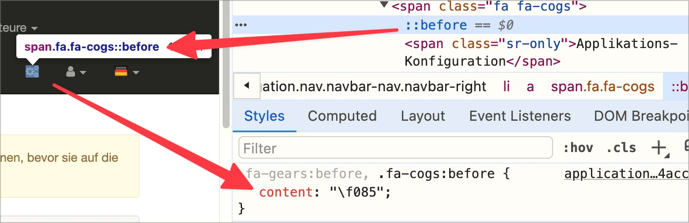

# ✅ Grafische Symbole

WCAG-Kriterium: [📜 1.1.1 Nicht-Text-Inhalt - A](..)

## Beschreibung

Grafische Symbole (z.B. Webfonts oder Emojis) sind so umgesetzt, dass sie nicht zu unverständlichen Ausgaben durch Screenreader führen.

## Prüfmethode (in Kürze)

**Screenreader:** Symbole vorlesen lassen und sicher stellen, dass keine unerwarteten/unpassenden Ausgaben passieren.

## Prüfmethode für Web (ausführlich)

### Prüf-Schritte

1. Seite öffnen
1. Mit [🏷️ NVDA Screenreader](/de/tags/nvda-screenreader) die Inhalte lesen
1. Sicherstellen, dass symbolhafte Schriftzeichen sinnvoll ausgegeben werden
    - **🙂 Beispiel:** Ein per Webfont eingebundenes "User" Symbol wird als "Benutzer" o.ä. angesagt
        - **😡 Beispiel:** Es wird unverständlich ausgegeben, etwa ???
        - **😡 Beispiel:** Es wird gar nichts ausgegeben
    - **🙄 Beispiel:** In einer Meteo-Prognose wird die Windrichtung durch unterschiedliche Pfeile angesagt, z.B. "Pfeil nach rechts" oder "Pfeil nach rechts oben"
        - ⚠️ Tendenziell sollte hier aber ein spezifischer Alternativtext gesetzt werden, z.B. "Windstärke bleibt gleich" bzw. "Windstärke nimmt zu"
    - **😡 Beispiel:** In einem Webshop wird das Emoji "🚨" eingesetzt, um anzuzeigen, dass ein Element nicht verfügbar ist; dieses wird allerdings nicht einheitlich von Screenreadern ausgegeben (VoiceOver sagt z.B. "Rotes Blinklicht", NVDA hingegen "Polizeilicht").
        - ⚠️ Viele Emojis sind nicht eindeutig in ihrer Bedeutung, auch über kulturelle Grenzen hinweg! Im Zweifelsfall besser einen Alternativtext via z.B. `aria-label` setzen.

## Prüfmethode für Mobile (Ergänzungen zu Web)

Sowohl auf Web-Views als auch native Inhalte 1:1 übertragbar.

## Prüfmethode für PDF (Ergänzungen zu Web)

### Prüf-Schritte
1. PDF mit [🏷️ Adobe Reader](/de/tags/adobe-reader) öffnen
1. Mit [🏷️ NVDA Screenreader](/de/tags/nvda-screenreader) vorlesen lassen und/oder
1. Prüfen, dass grafische Elemente wie Symbole vorgelesen werden. Dies ist nur der Fall, wenn für Symbole oder andere grafische Elemente ein "Tatsächlicher Text" hinterlegt worden ist.

## Details zum blinden Testen

Eingeschränkt: wenn gewisse Zeichen zu störenden Ausgaben führen, kann das ggf. korrekt durch Screenreader-Experten erkannt werden. Oft ist aber der Kontext gar nicht klar (z.B. "Was soll 'rotes Blinklicht' bedeuten?"), oder die Zeichen werden gar nicht ausgegeben bzw. führen zu schwer verständlichen Ausgaben (z.B. Webfonts).

## Screenshots typischer Fälle

