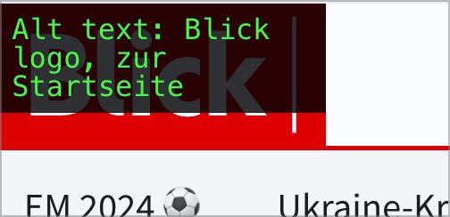
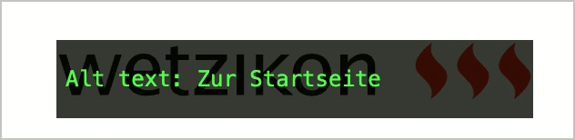

# ✅ Verlinktes Seiten-Logo

WCAG-Kriterium: [📜 1.1.1 Nicht-Text-Inhalt - A](..)

## Beschreibung

Das Seiten-Logo (mit Link zur Startseite) verfügt über eine sinnvolle Textalternative (Muster `alt="Logo Firmenname, zur Startseite"`)

## Prüfmethode (in Kürze)

**Web Developer Toolbar:** Images > Display Alt Attributes: Angezeigte Alternativtexte mit Bildern abgleichen.

## Prüfmethode für Web (ausführlich)

### Prüf-Schritte

1. Seite öffnen
1. [🏷️ Image Alt Text Viewer Extension](/de/tags/image-alt-text-viewer-extension) ausführen (oder in [🏷️ Web Developer Extension](/de/tags/web-developer-extension) unter "Images" → "Display Alt Attributes" wählen)
1. Sicherstellen, dass verlinkte Seiten-Logos einen passenden Alternativtext aufweisen
    - ⚠️ Für sonstige verlinkte Grafiken existiert [✅ Verlinkte Grafiken](/de/wcag/1.1.1-nicht-text-inhalt/verlinkte-grafiken)!
    - **🙂 Beispiel:** Das Logo einer Firma verlinkt auf die Startseite; der Alternativtext ist "Logo ACME Inc., zur Startseite"
        - **😡 Beispiel:** Bei "ACME Inc." alleine fehlt das Linkziel
        - **😡 Beispiel:** Bei "Zur Startseite" alleine fehlt der Bildinhalt
    - **🙂 Beispiel:** Das Logo einer Firma ist **nicht** verlinkt; der Alternativtext ist "Logo ACME Inc."

## Prüfmethode für Mobile (Ergänzungen zu Web)

Sowohl auf Web-Views als auch native Inhalte 1:1 übertragbar.

## Prüfmethode für PDF (Ergänzungen zu Web)

Für PDF nicht anwendbar.

## Details zum blinden Testen

Ja.

## Screenshots typischer Fälle

