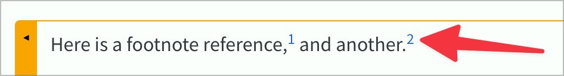

# ✅ Fussnoten

WCAG-Kriterium: [📜 1.3.1 Info und Beziehungen - A](..)

## Beschreibung

Fussnoten sind barrierefrei umgesetzt: Auch mit einem Screenreader ist beim Fussnoten-Zeichen der Zugriff auf den Fussnotentext gegeben, ohne dass der ursprüngliche Kontext verloren geht.

## Prüfmethode (in Kürze)

**Screenreader:** Elemente erkunden, mit ihnen interagieren und Ausgaben prüfen: Sind verbundene Informationen einfach auffindbar? Gelingt etwaige Navigation zwischen Text und Fussnote?

## Prüfmethode für Web (ausführlich)

### Prüf-Schritte

1. Seite öffnen
1. Mit [🏷️ NVDA Screenreader](/de/tags/nvda-screenreader) Fussnoten lesen und bedienen
1. Sicherstellen, dass Fussnoten funktionieren und man den Kontext nicht verliert
    - **🙂 Beispiel:** Eine Fussnote zum Begriff "Ländlermusik" wird als "Fussnote 1: Ländlermusik" angesagt: sie ist ein in-Page-Link und beim Aktivieren springt man zur Definition; dort hat es wiederum einen in-Page-Link zurück nach oben zur "Fussnote 1".
        - **🙄 Beispiel:** Die Fussnote wird als "Fussnote 1" angesagt; dies ist zwar ausreichend, aber z.B. ohne Kontext (z.B. in einer Link-Liste) ist es wenig aussagekräftig
        - **😡 Beispiel:** Die Fussnote wird als "1" angesagt und ist nicht verlinkt
        - **🙄 Beispiel:** Die Fussnote ist zur Definition hin verlinkt, aber nicht mehr zurück → über die "Zurück"-Funktion des Browsers kann ggf. wieder an die ursprüngliche Stelle gesprungen werden, aber z.B. innerhalb eines Formulars ist man eher vorsichtig, diese Funktion zu nutzen (um nicht versehentlich Eingaben wieder zu löschen)

## Prüfmethode für Mobile (Ergänzungen zu Web)

Sowohl auf Web-Views als auch native Inhalte 1:1 übertragbar.

## Prüfmethode für PDF (Ergänzungen zu Web)

### Prüf-Schritte
1. PDF mit [🏷️ Adobe Reader](/de/tags/adobe-reader) öffnen
1. Mit [🏷️ NVDA Screenreader](/de/tags/nvda-screenreader) Fussnoten lesen und bedienen
1. Sicherstellen, dass Fussnoten funktionieren und man den Kontext nicht verliert

## Details zum blinden Testen

Ja (falls die Fussnoten überhaupt als solche erkannt werden).

## Screenshots typischer Fälle

