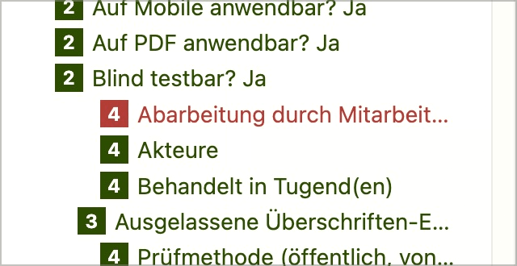

# ✅ Sprünge zwischen Überschriften-Ebenen

WCAG-Kriterium: [📜 1.3.1a Überschriften-Struktur](..)

## Beschreibung

Es existieren möglichst keine Sprünge zwischen Überschriften-Ebenen, wobei eine einzelne Ebene toleriert wird (z.B. `<h2>` zu `<h4>`, aber nicht zu `<h5>`).

Die erste Überschrift muss jedoch nicht zwingend eine `<h1>` sein.

## Prüfmethode (in Kürze)

**Bookmarklet h123:** Ausführen und nach Sprüngen in der Hierarchie suchen.

## Prüfmethode für Web (ausführlich)

### Prüf-Schritte

1. Seite öffnen
1. [🏷️ H123 Bookmarklet](/de/tags/h123-bookmarklet) ausführen
1. Sicherstellen, dass keine Überschriften übersprungen werden:
    - **🙂 Beispiel:** Auf `<h1>Meine Hobbys</h1>` folgt `<h2>Fussball spielen</h2>`
    - **🙂 Beispiel:** Auf `<h2>Navigation</h2>` folgt `<h3>Inhalts-Navigation</h3>`
    - **🙄 Beispiel:** Auf `<h1>Meine Hobbys</h1>` folgt `<h3>Fussball spielen</h3>`
        - ⚠️ Eine einzelne übersprungene Ebene lassen wir normalerweise durchgehen
    - **😡 Beispiel:** Auf `<h2>Navigation</h2>` folgen `<h5>Inhalts-Navigation</h5>`
    - **🙂 Beispiel:** Die allererste Überschrift "Kopfbereich" startet auf `<h2>` (statt `<h1>`) → ⚠️ Dies wird oft gemacht, weil man für die Suchmaschinen-Optimierung nur eine einzige `<h1>` haben möchte (die dann den Inhalts-Bereich bezeichnet)
        - **🙄 Beispiel:** Diese erste Überschrift startet auf `<h5>` oder `<h6>` → ⚠️ Das ist dann doch etwas "zuviel des Guten" und wir raten, mit `<h2>` zu beginnen

### Nachprüfen mit Screenreader

Bei zweifelhaftem Code (z.B. Einsatz von `role="heading"`) sollte besser mit [🏷️ NVDA Screenreader](/de/tags/nvda-screenreader) nachgeprüft werden:

- Die Elementliste (`Insert`+`F7`) weist nicht auf Sprünge hin (die Baumstruktur wird automatisch repariert)!
- Entsprechend muss manuell eruiert werden, ob es zu Sprüngen kommt:
    - Überschriften mit `H` anspringen und sicherstellen, dass keine Ebenen übersprungen werden

⚠️ Denn: viele Fehler findet man oft auch ohne Screenreader, z.B. wenn die Semantik komplett fehlt oder offensichtlich falsch ist. Wenn Semantik aber grundsätzlich **vorhanden scheint**, lässt sich deren Korrektheit und Sinnhaftigkeit oft nur mit Screenreader final beurteilen.

## Prüfmethode für Mobile (Ergänzungen zu Web)

Auf Web-Views 1:1 übertragbar; zu prüfen mittels Überschriften-Navigation (im [🏷️ Rotor](/de/tags/rotor) aktivieren).

In nativen Apps hingegen gibt es semantisch nur eine Überschriften-Stufe (auch wenn Überschriften visuell unterschiedlich dargestellt werden können).

## Prüfmethode für PDF (Ergänzungen zu Web)

### Prüf-Schritte
1. PDF mit [🏷️ Adobe Reader](/de/tags/adobe-reader) öffnen
1. Mit [🏷️ NVDA Screenreader](/de/tags/nvda-screenreader) vorlesen lassen und/oder
1. Mit [🏷️ PDF Accessibility Checker (PAC)](/de/tags/pdf-accessibility-checker-pac) testen und Screenreader-Vorschau öffnen und/oder
1. Mit [🏷️ Adobe Acrobat](/de/tags/adobe-acrobat) Adobe Acrobat (falls vorhanden) öffnen und Tag-Baum untersuchen

## Details zum blinden Testen

Überschriften sind für Blinde besonders wichtig!

## Screenshots typischer Fälle

