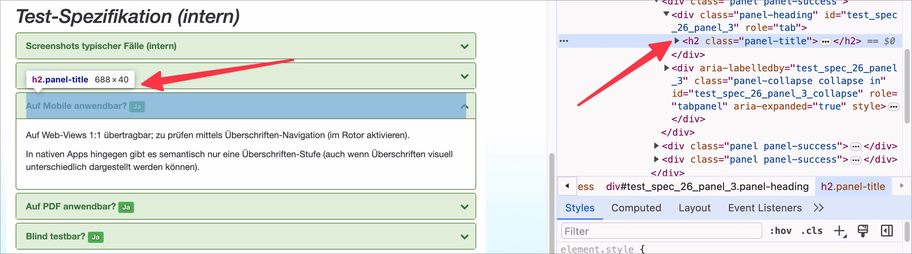

# ✅ Überschriften für Akkordeons

WCAG-Kriterium: [📜 1.3.1a Überschriften-Struktur](..)

## Beschreibung

Überschriften für Akkordeons sind als solche implementiert.

## Prüfmethode (in Kürze)

**Bookmarklet h123:** Ausführen und mit Seite abgleichen: Sind Überschriften in Akkordeons als solche implementiert?

## Prüfmethode für Web (ausführlich)

### Prüf-Schritte

1. Seite mit Akkordeon öffnen
1. [🏷️ H123 Bookmarklet](/de/tags/h123-bookmarklet) ausführen
1. Sicherstellen, dass Akkordeon-Toggler als Überschriften ausgezeichnet sind:
    - ⚠️ Besonders wenn die Inhalte des Akkordeons ebenfalls Überschriften aufweisen, ist das wichtig. Bei sehr simplen Akkordeons mit nur wenig Inhalt kann dies überflüssig sein.
    - **🙂 Beispiel:** Bei einem Rezept sind "Zutaten", "Anleitung" und "Tipps" als Akkordeon-Toggler auf- und zuklappbar; sie sind als Überschrift ausgezeichnet.
        - **😡 Beispiel:** Die Toggler sind **nicht** also Überschrift ausgezeichnet
    - **🙄 Beispiel:** Kommentare unterhalb eines Blog-Posts können einzeln auf- und zugeklappt werden: der Name des Autors ist der Toggler, der Inhalt enthält nur einfachem Text; die Toggler sind **nicht** als Überschriften ausgezeichnet.
        - ⚠️ In diesem einfachen Fall reicht es, wenn der Name als Paragraf und der Kommentar als Paragraf, ggf. mit einfachen Listen o.ä. dargestellt werden. Wir raten trotzdem, Überschriften zu verwenden, da die Navigation für Screenreader deutlich einfacher wird. Generelle Faustregel: wenn's wie eine Überschrift aussieht, sollte es auch als solche ausgezeichnet sein!

### Nachprüfen mit Screenreader

Bei zweifelhaftem Code (z.B. Einsatz von `role="heading"`) sollte besser mit [🏷️ NVDA Screenreader](/de/tags/nvda-screenreader) nachgeprüft werden:

- Überschriften mit `H` versuchen anzuspringen.

⚠️ Denn: viele Fehler findet man oft auch ohne Screenreader, z.B. wenn die Semantik komplett fehlt oder offensichtlich falsch ist. Wenn Semantik aber grundsätzlich **vorhanden scheint**, lässt sich deren Korrektheit und Sinnhaftigkeit oft nur mit Screenreader final beurteilen.

## Prüfmethode für Mobile (Ergänzungen zu Web)

Sowohl auf Web-Views als auch native Inhalte 1:1 übertragbar; zu Prüfen mittels Überschriften-Navigation (im [🏷️ Rotor](/de/tags/rotor) aktivieren).

## Prüfmethode für PDF (Ergänzungen zu Web)

Es gibt keine Akkordeons in PDFs.

## Details zum blinden Testen

Überschriften sind für Blinde besonders wichtig! Voraussetzung zum Testen ist, dass das Akkordeon als solches auch vom Screenreader-Nutzer erkannt und bedient werden kann (siehe [✅ Akkordeons](/de/wcag/4.1.2a-erweiterte-steuerelemente-widgets/akkordeons)).

## Screenshots typischer Fälle

