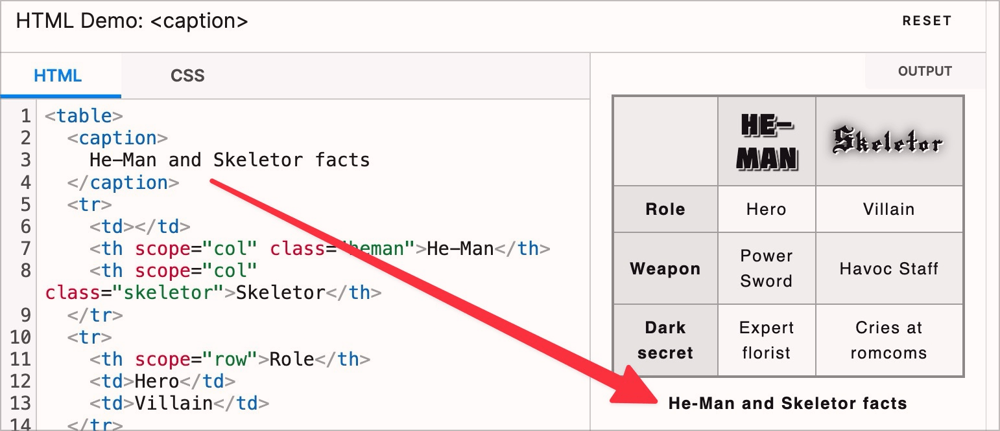

# ✅ Tabellenüberschriften

WCAG-Kriterium: [📜 1.3.1d Tabellarische Daten](..)

## Beschreibung

Insbesondere komplexe Daten-Tabellen weisen Tabellenüberschriften (`<caption>`) auf.

## Prüfmethode (in Kürze)

**Screenreader:** Tabelle erkunden und prüfen, ob `<caption>`-Element dabei auch ausgegeben wird.

## Prüfmethode für Web (ausführlich)

### Prüf-Schritte

1. Seite öffnen
1. [🏷️ Tables Bookmarklet](/de/tags/tables-bookmarklet) ausführen
1. Sicherstellen, dass (insbesondere ausführliche) Tabellen eine Beschriftung (`<caption>`) haben
    - **🙂 Beispiel:** Eine ausführliche Tabelle hat die Beschriftung "Mitgliedstaaten der UNO"
    - **🙄 Beispiel:** Eine relativ kleine Tabelle hat eine Beschriftung mit `aria-label`
        - ⚠️ Wir ermuntern unsere Kunden, möglichst für alle Nutzenden dasselbe Erlebnis zu bieten: das `aria-label` für Screenreader (anstelle einer visuell sichtbaren `<caption>`) ist gut gemeint, aber auch sehende Nutzer würden ggf. von der Beschriftung profitieren
    - **🙄 Beispiel:** Eine relativ kleine Tabelle hat gar keine Beschriftung
        - ⚠️ Wir ermuntern unsere Kunden, Tabellen generell zu beschriften
    - **😡 Beispiel:** Eine ausführliche Tabelle hat gar keine Beschriftung

### Nachprüfen mit Screenreader

Bei zweifelhaftem Code (z.B. Einsatz von `role="table"`) sollte besser mit [🏷️ NVDA Screenreader](/de/tags/nvda-screenreader) nachgeprüft werden:

- Mit `T` zu Tabelle springen

⚠️ Denn: viele Fehler findet man oft auch ohne Screenreader, z.B. wenn die Semantik komplett fehlt oder offensichtlich falsch ist. Wenn Semantik aber grundsätzlich **vorhanden scheint**, lässt sich deren Korrektheit und Sinnhaftigkeit oft nur mit Screenreader final beurteilen.

## Prüfmethode für Mobile (Ergänzungen zu Web)

Sowohl auf Web-Views als auch native Inhalte 1:1 übertragbar. Da man Tabellen aber nicht spezifisch anspringen kann, ist es ggf. schwierig herauszufinden, ob die Beschriftung einer Tabelle tatsächlich als `<caption>` implementiert wurde, oder ob ein anderer Mechanismus verwendet wurde (z.B. einfach nur ein `
` oberhalb der Tabelle).

## Prüfmethode für PDF (Ergänzungen zu Web)

### Prüf-Schritte
1. PDF mit [🏷️ Adobe Reader](/de/tags/adobe-reader) öffnen
1. Mit [🏷️ NVDA Screenreader](/de/tags/nvda-screenreader) vorlesen lassen und/oder
1. Mit [🏷️ PDF Accessibility Checker (PAC)](/de/tags/pdf-accessibility-checker-pac) testen und Screenreader-Vorschau öffnen und/oder
1. Mit [🏷️ Adobe Acrobat](/de/tags/adobe-acrobat) (falls vorhanden) öffnen und Tag-Baum untersuchen
1. Analog zu Web: Prüfen, ob komplexe Tabellen eine Beschriftung haben. Bei der Überprüfung des Tag-Baums ist darauf zu achten, dass ein `<caption>`-Tag das erste oder letzte Kind-Element innerhalb eines `<table>`-Tags ist.

## Details zum blinden Testen

Beschriftungen von Tabellen sind für Blinde besonders wichtig!

## Screenshots typischer Fälle

