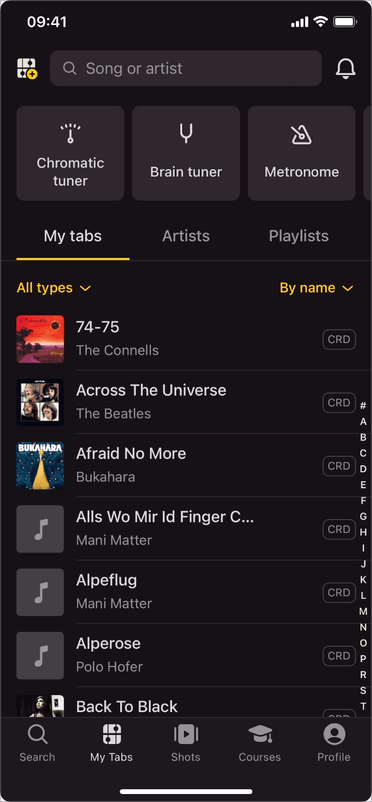
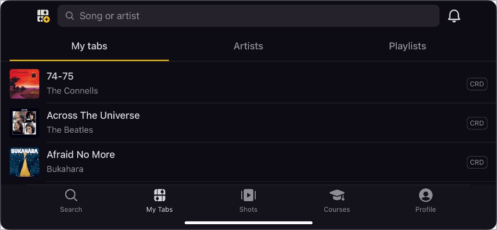
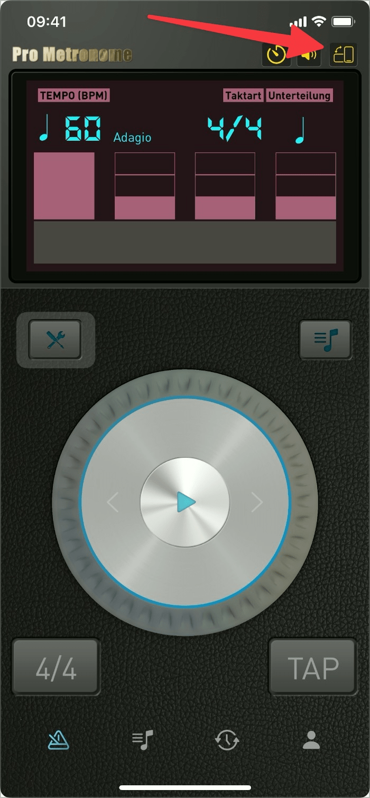

# ✅ Hoch- und Querformat

WCAG-Kriterium: [📜 1.3.4 Ausrichtung - AA](..)

## Beschreibung

Inhalte sind in beiden Bildschirmorientierungen (Hoch- und Querformat) korrekt dargestellt und nutzbar. Passt sich der Inhalt nicht automatisch an die Bildschirmorientierung an, steht ein Schalter zur Verfügung zum manuellen Drehen des Bildschirminhalts (für Websites vom Browser sichergestellt, für Mobile Apps durch Design und Entwicklung sicherzustellen).

## Prüfmethode (in Kürze)

**Manuelle Prüfung:** Statt ein echtes mobiles Gerät zu verwenden, können diverse Browser das Rotieren der Ausrichtung auch simulieren, in etwa Firefox: Responsive Design Mode > Rotate View Port.

## Prüfmethode für Web (ausführlich)

### Test-Schritte

Desktop-Computer haben stets nur eine Ausrichtung (egal ob der Bildschirm Hoch- oder Querformat hat).

⚠️ Dies ist eine der sehr seltenen WCAG-Kriterien, welche sich hauptsächlich auf Mobile-Anwendung beziehen.

## Prüfmethode für Mobile (Ergänzungen zu Web)

Webseiten sind "von Natur aus" fluid aufgebaut und füllen den Bildschirm bzw. Browser automatisch. Die automatische Anpassung an Hoch- bzw. Querformat kann manuell unterbunden werden, dies trat bisher aber kaum je auf.

Mobile Apps hingegen müssen spezifisch so programmiert werden, dass sie sich an das Bildschirmformat anpassen können. Dies kann aufwändig sein und wird deshalb allzu oft ignoriert. Zum Testen muss der "Screen Lock" inaktiv sein: dann einfach das Mobile Phone drehen und schauen, ob die App reagiert (oder ob ein spezifischer Schalter zum Wechsel zwischen Hoch- und Querformat existiert).

## Prüfmethode für PDF (Ergänzungen zu Web)

Für PDF nicht relevant.

## Details zum blinden Testen

Nein.

## Screenshots typischer Fälle

