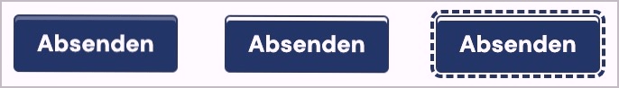

# ✅ Kontrast von interaktiven Textelementen

WCAG-Kriterium: [📜 1.4.3 Kontrast (Minimum) - AA](..)

## Beschreibung

Interaktive Textelemente (z.B. Schalterbeschriftungen) erfüllen die Kontrastanforderung von `4.5:1` in allen Zuständen (fokussiert, bei Mouseover, etc.) gleichermassen. Für die Unterscheidbarkeit zwischen den Zuständen eines interaktiven Elements gelten keine strikten Kontrastanforderungen.

## Prüfmethode (in Kürze)

**Manuelle Prüfung:** Elemente durchsehen, mit ihnen interagieren und auf schwache Kontraste achten. Kontrastermittlung ggf. durch Colour Contrast Analyser.

## Prüfmethode für Web (ausführlich)

### Prüf-Schritte

1. Seite öffnen
1. Mit [🏷️ Color Contrast Analyzer](/de/tags/color-contrast-analyzer) jeweils die Vorder- und Hintergrundfarbe eines interaktiven Elements wählen
    - ⚠️ Das Nutzen der Farb-Pipette kann ungenau sein! Wenn Ergebnisse knapp sind (z.B. ein knapp ungenügendes `4.3:1` bei kleiner Schrift oder ein knapp genügendes `3.1:1` bei grosser), dann müssen die Farbwerte manuell eruiert (mittels [🏷️ DOM Inspektor](/de/tags/dom-inspektor)) und nochmal eingegeben werden
1. Sicherstellen, dass die Kontraste ausreichend sind
    - **🙂 Beispiel:** Ein grosser Schalter (ab `18pt` oder `14pt` + fett) hat einen Kontrastwert von mind. `3:1`
        - **😡 Beispiel:** Der Kontrastwert ist kleiner als `3:1`
    - **🙂 Beispiel:** Ein kleiner Schalter hat einen Kontrastwert von mind. `4.5:1`
        - **😡 Beispiel:** Der Kontrastwert ist kleiner als `4.5:1`
1. Das Element mit der Maus hovern bzw. fokussieren und den Prozess jeweils wiederholen
    - ⚠️ Auch diese Zustandsänderungen müssen die Anforderungen erfüllen; für die Unterscheidbarkeit zwischen denselben gelten auf Stufe AA allerdings keine strikten Kontrastanforderungen.

⚠️ Mit etwas Übung entwickelt man schnell ein Gefühl, ob ein Element gute oder schlechte Kontraste hat. Entsprechend ist eine pragmatische Herangehensweise zu empfehlen, indem man insbesondere Elemente, die als potenziell kontrastarm wahrgenommen werden, mit obigem Testverfahren überprüft. Aber Vorsicht: Der Farbton spielt bei der Berechnung des Kontrasts keine Rolle, weshalb z.B. ein sattes Grün und ein sattes Rot (welche für Normalsehende klar unterscheidbar sind) wider Erwarten zu wenig Kontrast aufweisen!

## Prüfmethode für Mobile (Ergänzungen zu Web)

Sowohl auf Web-Views als auch native Inhalte 1:1 übertragbar. Das Testen der Kontrastwerte kann über Screenshots geschehen, oder über [🏷️ Screen Mirroring](/de/tags/screen-mirroring) auf den Desktop. Dabei muss beachtet werden, dass Kompressions-Verfahren die Farben leicht verändern können!

## Prüfmethode für PDF (Ergänzungen zu Web)

Prüfschritte analog zu Web

## Details zum blinden Testen

Nein.

## Screenshots typischer Fälle

