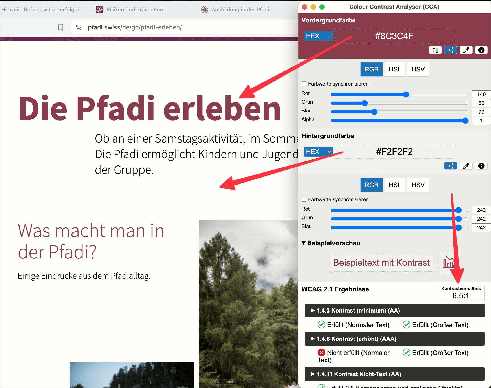

# ✅ Kontrastverhältnis bei Text

WCAG-Kriterium: [📜 1.4.3 Kontrast (Minimum) - AA](..)

## Beschreibung

Das Kontrastverhältnis bei Text und Bildern von Text zum Hintergrund beträgt mindstens `4.5:1` bei normaler Schriftgrösse und mindestens `3:1` bei grosser Schrift (definiert als mindestens `18pt` oder `14pt + fett`). Das gilt sowohl für normale Schrift zur Hintergrundfarbe (alle Texte und Hinweise) als auch für Texte in informativen grafischen Elementen, ist aber nicht zwingend für Logos oder rein dekorative Grafiken.

## Prüfmethode (in Kürze)

**Manuelle Prüfung:** Inhalte durchsehen und auf schwache Kontraste achten. Kontrastermittlung ggf. durch Colour Contrast Analyser.

## Prüfmethode für Web (ausführlich)

### Prüf-Schritte

1. Seite öffnen
1. Mit [🏷️ Color Contrast Analyzer](/de/tags/color-contrast-analyzer) jeweils die Vorder- und Hintergrundfarbe eines Texts wählen
    - ⚠️ Das Nutzen der Farb-Pipette kann ungenau sein! Wenn Ergebnisse knapp sind (z.B. ein knapp ungenügendes `4.3:1` bei kleiner Schrift oder ein knapp genügendes `3.1:1` bei grosser), dann müssen die Farbwerte manuell eruiert (mittels [🏷️ DOM Inspektor](/de/tags/dom-inspektor)) und nochmal eingegeben werden
1. Sicherstellen, dass die Kontraste ausreichend sind
    - **🙂 Beispiel:** Ein grosser Schriftzug (ab `18pt` oder `14pt` + fett) hat einen Kontrastwert von mind. `3:1`
        - **😡 Beispiel:** Der Kontrastwert ist kleiner als `3:1`
    - **🙂 Beispiel:** Ein kleiner Schriftzug hat einen Kontrastwert von mind. `4.5:1`
        - **😡 Beispiel:** Der Kontrastwert ist kleiner als `4.5:1`
    - **🙂 Beispiel:** Eine Webseite zeigt neben Links, die auf eine andere Webseite zeigen, ein entsprechendes Symbol ("Öffnet in neuem Fenster") an
    - **🙂 Beispiel:** Eine Webseite zeigt neben Geldbeträgen ein entsprechendes grafisches Symbol (z.B. USD oder CHF) an; diese haben ebenfalls den geforderten Kontrastwert
    - **🙂 Beispiel:** Ein Eingabefeld in einem Formular hat einen `placeholder`, welcher das einzugebende Format anzeigt (z.B. `MM/YY` für das Ablaufdatum einer Kreditkarte); dieser hat ebenfalls den geforderten Kontrastwert
        - ⚠️ `placeholder` sind aus verschiedenen Gründen ein schwieriges Thema bezüglich Barrierefreiheit: z.B. sind sie "von Natur aus" sehr kontrastarm, damit gut erkennbar wird, ob man bereits eine Eingabe getätigt hat oder nicht. Dies aber widerspricht den vorliegenden Kontrastanforderungen, weshalb es schwierig ist, einen "Sweet Spot" zu finden. Generell empfehlen wir, `placeholder` nur als redundante oder beispielhafte Information zu verwenden, und ein Eingabeformat etwa als zusätzlicher Text unterhalb des Eingabefelds anzuzeigen.

⚠️ Mit etwas Übung entwickelt man schnell ein Gefühl, ob ein Element gute oder schlechte Kontraste hat. Entsprechend ist eine pragmatische Herangehensweise zu empfehlen, indem man insbesondere Elemente, die als potenziell kontrastarm wahrgenommen werden, mit obigem Testverfahren überprüft. Aber Vorsicht: Der Farbton spielt bei der Berechnung des Kontrasts keine Rolle, weshalb z.B. ein sattes Grün und ein sattes Rot (welche für Normalsehende klar unterscheidbar sind) wider Erwarten zu wenig Kontrast aufweisen!

## Prüfmethode für Mobile (Ergänzungen zu Web)

Sowohl auf Web-Views als auch native Inhalte 1:1 übertragbar. Das Testen der Kontrastwerte kann über Screenshots geschehen, oder über [🏷️ Screen Mirroring](/de/tags/screen-mirroring) auf den Desktop. Dabei muss beachtet werden, dass Kompressions-Verfahren die Farben leicht verändern können!

## Prüfmethode für PDF (Ergänzungen zu Web)

Prüfschritte analog zu Web

## Details zum blinden Testen

Nein.

## Screenshots typischer Fälle

