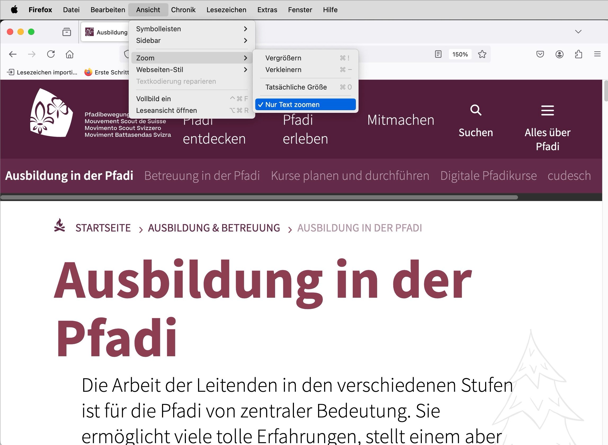

# ✅ 200% Zoom

WCAG-Kriterium: [📜 1.4.4 Textgrösse ändern - AA](..)

## Beschreibung

Elemente sind auf mindestens 200% zoombar, entweder der Text allein oder die komplette Seite (für Websites in der Regel vom Browser sichergestellt, für Mobile Apps durch Design und Entwicklung sicherzustellen).

## Prüfmethode (in Kürze)

**Browser:** Zoom schrittweise auf 200% erhöhen und auf erwartungsgemässe Anpassung der Inhalte achten.

## Prüfmethode für Web (ausführlich)

### Prüf-Schritte

1. Seite öffnen
1. Zoom-Funktion des Browsers auf 200% setzen
    - Chrome: Mehrmals `Anzeigen` → `Vergrössern` wählen
    - Firefox: Mehrmals `Ansicht` → `Zoom` → `Vergrössern` wählen (die Option `Nur Text zoomen` muss inaktiv sein)
1. Sicherstellen, dass alle Inhalte weiterhin gut lesbar (dass es z.B. nicht zu Überlappungen o.ä. der Inhalte kommt)

⚠️ Früher war es im Internet Explorer nicht möglich, Webseiten als Ganzes zu zoomen. Stattdessen wurden nur Textelemente gezoomt (sozusagen die Schriftgrösse verändert), wobei es zu unschönen Überlappungen von Inhalten kommen konnte; manchmal war das Zoomen auch komplett unmöglich (falls Schriftgrössen mittels `px` festgelegt waren statt mit `em`). Heute wird standardmässig stets die ganze Webseite gezoomt, weshalb vorliegendes Erfolgskriterium kaum mehr verletzt wird. Oft wird anstelle der Desktop-Version einfach irgendwann die Mobile-Version angezeigt, was zu keinen Problemen führen sollte.

## Prüfmethode für Mobile (Ergänzungen zu Web)

Sowohl auf Web-Views als auch native Inhalte 1:1 übertragbar.

**iOS:** `Einstellungen` → `Bedienungshilfen` → `Anzeige & Textgrösse` → `Grösserer Text` aktivieren, dann Schieberegler für die Textgrösse ganz nach rechts schieben. Manche Apps müssen neugestartet werden, damit der Effekt eintritt.

**Android:** `Anzeige` → `Schriftgrösse` → Grösse wählen.

Es ist in Mobile Apps manchmal schwierig zu eruieren, ob Schriften sich tatsächlich auf mind. 200% vergrössern. Manchmal vergrössern sie sich zwar, aber ggf. auf weniger als 200%, oder die Vergrösserung scheint nicht einheitlich über unterschiedliche Elemente hinweg zu sein.

## Prüfmethode für PDF (Ergänzungen zu Web)

## Details zum blinden Testen

Nein.

## Screenshots typischer Fälle

