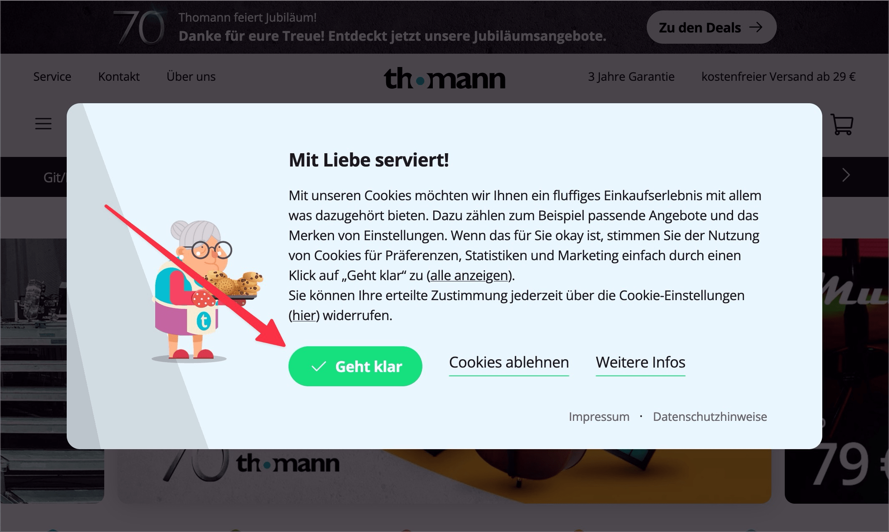

# ✅ Fokus-Führung

WCAG-Kriterium: [📜 2.4.3 Fokus-Reihenfolge - A](..)

## Beschreibung

Der Tastatur-Fokus wird sinnvoll geführt, wenn jemand mit Elementen auf der Seite interagiert, die zu einer Veränderung innerhalb der Seite führen (ohne Seiten-Reload), z.B. nach dem Klick auf einen Schalter, der einen Dialog anzeigt (Erreichen des Dialogs und Interagieren im Dialog, Verlassen desselben, Fokus zurück auf das dialog-auslösende Element, Weiternavigieren auf der Seite). Auch die Interaktion mit Formular-Elementen kann durch sinnvolle Fokus-Führung ggf. optimiert werden.

## Prüfmethode (in Kürze)

**Tastatur:** Durch Elemente navigieren mittels Tab-Taste, mit ihnen interagieren und darauf achten, dass die Fokus-Reihenfolge und -Führung sinnvoll ist.

## Prüfmethode für Web (ausführlich)

### Prüf-Schritte

1. Seite öffnen
1. Mit `Tab`-Taste durch die Seite navigieren:
    - Falls Fokus schlecht (oder gar nicht) sichtbar → [🏷️ NerdeFocus Extension](/de/tags/nerdefocus-extension) aktivieren
1. Elemente aktivieren (`Enter`-Taste), welche potenziell In-Page-Änderungen (siehe unten) mit Interaktions-Aufforderung (siehe unten) bewirken und jeweils prüfen:
    - Wird der Fokus daraufhin an einen sinnvollen Ort gesetzt?
        - **🙂 Beispiel:** Ein Dialog öffnet sich und der Fokus wird auf dessen "Schliessen"-Schalter gesetzt
            - Der Schalter muss sich im DOM vor dem eigentlichen Dialog-Inhalt befinden, damit Screenreader-Nutzende beim Weiterlesen den Inhalt nicht verpassen (siehe [✅ Korrekte Reihenfolge](/de/wcag/1.3.2-bedeutungsvolle-reihenfolge/korrekte-reihenfolge))!
        - **🙄 Beispiel:** Der Fokus wird auf den gesamten Dialog gesetzt.
            - ⚠️ Verhindert die direkte Interaktion mit Tastatur (`Tab` muss erst gedrückt werden, um "Schliessen"-Schalter zu erreichen)
            - ⚠️ Der gesamte Dialog-Inhalt wird vom Screenreader automatisch vorgelesen (meistens nicht gewünscht)
        - **😡 Beispiel:** Ein Dialog öffnet sich, aber der Fokus bleibt im Hintergrund.
    - Wenn der neu eingeblendete Inhalt wieder geschlossen werden kann: wird nach dem Schliessen der Fokus erneut an einen sinnvollen Ort gesetzt?
        - **🙂 Beispiel:** Der Fokus wird zurück auf den "AGBs anzeigen"-Schalter gesetzt.
        - **😡 Beispiel:** Der Fokus geht verloren (`Tab` startet wieder am Anfang der Seite).

### In-Page-Änderung (vs. Reload)

Fokus-Führung ist dann wichtig, wenn sich etwas auf der **aktuellen Seite verändert** (In-Page) und sogleich die Aufmerksamkeit des Nutzenden fordert:

- Dies kann auf eine Aktion des Nutzenden erfolgen, etwa wenn ein Klick auf "AGBs anzeigen" einen Dialog ([✅ Dialoge](/de/wcag/4.1.2a-erweiterte-steuerelemente-widgets/dialoge)) öffnet.
- Es kann aber auch ein Ereignis aus heiterem Himmel sein, etwa wenn beim e-Banking plötzlich die Meldung "Ihre Sitzung wird in 2 Minuten aufgrund von Inaktivität beendet" angezeigt wird.

Bei Neuladen der Seite (Reload) ist Fokus-Führung im Normalfall nicht notwendig (etwa wenn "AGBs anzeigen" keinen Dialog öffnet, sondern auf eine andere Seite verlinkt).

### Interaktions-Aufforderung (vs. Status-Meldung)

Fokus-Führung ist dann wichtig, wenn die In-Page-Änderung zu einer Interaktion aufruft:

- Der AGBs-Dialog muss über den "Schliessen"-Schalter geschlossen werden.
- Die obige Meldung im e-Banking bietet eine Schaltfläche "Sitzung jetzt verlängern" an.

Wenn es sich hingegen um einen reinen Hinweis handelt (etwa ohne Schaltfläche zur Verlängerung der Sitzung), so ist eine Status-Nachricht (ohne Fokus-Führung) sinnvoller, siehe [✅ Statusmeldungen](/de/wcag/4.1.3-statusmeldungen/statusmeldungen).

## Prüfmethode für Mobile (Ergänzungen zu Web)

Wird oft vergessen, aber auch Mobile Apps müssen komplett mit Tastatur gesteuert werden können.

## Prüfmethode für PDF (Ergänzungen zu Web)

Für PDFs nicht relevant.

## Details zum blinden Testen

Teilweise: Wird der Fokus versetzt, so kündet der Screenreader das neu fokussierte Element an. Wird der Fokus hingegen nicht versetzt, so kann der Screenreader-Nutzer zumindest mutmassen, dass es an mangelhafter Fokus-Führung liegt (und kann das neu geöffnete Element - z.B. einen Dialog - ggf. sogar manuell aufspüren).

Es kann aber auch ein anderes Problem vorliegen, welches schwieriger zu eruieren ist: z.B. wenn ein gedrückter Schalter visuell zwar als "gedrückt" erkennbar ist, aber kein entsprechendes Feedback vom Screenreader gegeben wird (z.B. durch `aria-pressed="true"`); dies wäre eher ein Fall für [📜-4.1.2 Name, Rolle, Wert](/de/wcag/4.1.2-name-rolle-wert) oder [📜-4.1.3 Statusmeldungen](/de/wcag/4.1.3-statusmeldungen).

## Screenshots typischer Fälle

