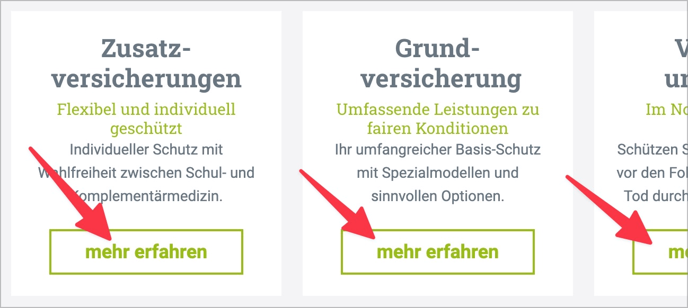

# ✅ Selbstsprechende Links

WCAG-Kriterium: [📜 2.4.4 Linkzweck (im Kontext) - A](..)

## Beschreibung

Link-Texte sind selbstsprechend, d.h. aus sich selbst heraus oder über den Kontext (gleiches `
`-Element, gleiches Listenelement, gleiche Tabellenzelle, Spalten- oder Zeilenüberschrift in Tabelle) verständlich.

## Prüfmethode (in Kürze)

**Screenreader:** Links auflisten und prüfen, ob diese selbstsprechend sind.

## Prüfmethode für Web (ausführlich)

### Prüf-Schritte

1. Seite öffnen
1. Link-Liste in Screenreader [🏷️ NVDA Screenreader](/de/tags/nvda-screenreader) anzeigen lassen (`Insert`-`F7`, dann `Alt`-`L`)
1. Sicherstellen, dass Links selbstsprechend sind:
    - **🙂 Beispiel:** "Mehr zum Thema X"
    - **🙂 Beispiel:** "Kontakt"
    - **🙄 Beispiel:** "Mehr" / "Weiter" o.ä. → wenn nur ein einziger Link mit diesem Namen existiert, kann es je nach Kontext okay sein
    - **🙄 Beispiel:** "Sehr gut, 4.9 von 5" → es ist einigermassen offensichtlich, dass es sich um eine Bewertung handelt, aber ein Zusatz wie "Aktuelle Bewertung" o.ä. wäre noch besser (kann visuell versteckt werden, siehe [🏷️ Inhalte rein visuell verstecken](/de/tags/inhalte-rein-visuell-verstecken))
    - **😡 Beispiel:** "Mehr" / "Weiter" o.ä. → wenn mehrere Links mit diesem Namen existieren
    - **😡 Beispiel:** "hier"
    - **😡 Beispiel:** Generell mehrfach vorkommende Links

## Prüfmethode für Mobile (Ergänzungen zu Web)

Links gibt es natürlich auch auf Mobile Webseiten und hybriden Apps.

In Mobile Apps werden solche Elemente manchmal auch als Schalter umgesetzt; streng genommen muss man das dann auch anwenden (obwohl es im engeren Sinn keine Links sind).

## Prüfmethode für PDF (Ergänzungen zu Web)

- Analog zu Web mit dem Screenreader prüfen, ob Linktexte selbstsprechend sind.
- Wenn der Link-Text identisch mit der verlinkten URL ist, muss ein alternativer Text vergeben sein, damit Screenreader diesen Text anstelle der URL vorliest.
- Zusätzlich mit Tastatur und Tabben testen, ob alle visuell sichtbaren Links auch mit der Tastatur erreichbar sind. Nur so ist sichergestellt, dass die Tag-Struktur für Links korrekt ist.

## Details zum blinden Testen

Das **muss** sogar mit einem Screenreader wie [🏷️ NVDA Screenreader](/de/tags/nvda-screenreader) getestet werden (man kann zwar durchaus auch visuell auf die Suche nach solchen Links gehen, aber oft muss man potenzielle Kandidaten genauer untersuchen, um wirklich sicher zu gehen, dass kein [🏷️ aria-label, aria-labelledby](/de/tags/aria-label-aria-labelledby) o.ä. existiert).

## Screenshots typischer Fälle

