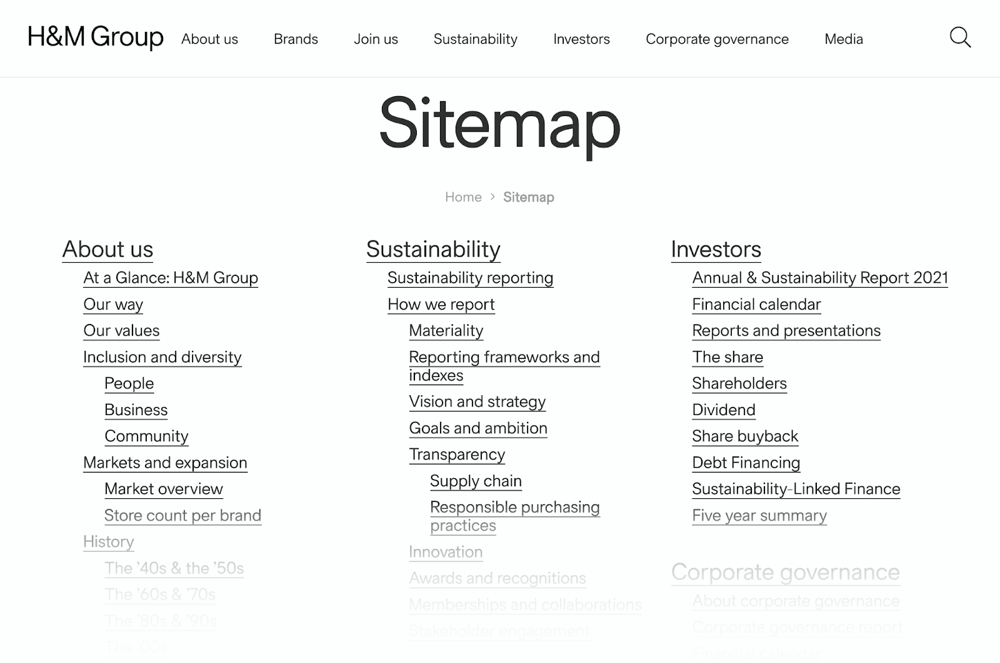
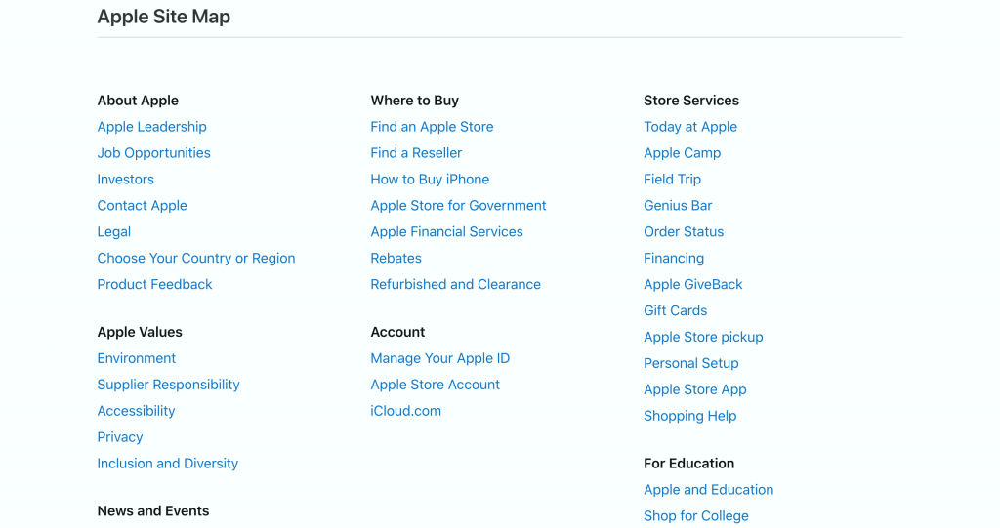

# ✅ Navigations-Methoden

WCAG-Kriterium: [📜 2.4.5 Verschiedene Möglichkeiten - AA](..)

## Beschreibung

Es existieren mindestens zwei der folgenden drei Methoden, um Zugang zu Inhalten zu bekommen: Navigation, Suchfunktion, Sitemap.

## Prüfmethode (in Kürze)

**Manuelle Prüfung:** Webauftritt durchsehen und prüfen, ob eine Suchfunktion oder Sitemap existiert.

## Prüfmethode für Web (ausführlich)

### Test-Schritte

1. Seite öffnen
1. Prüfen, ob die Seite mindestens 2 der 3 möglichen Methoden anbietet:
    - Navigation
    - Sitemap
    - Suche

## Prüfmethode für Mobile (Ergänzungen zu Web)

Für Mobile Webseiten relevant. Native Mobile Apps hingegen sind deutlich einfacher gebaut, weshalb diese Anforderung für sie nicht gilt.

## Prüfmethode für PDF (Ergänzungen zu Web)

Für PDFs nicht anwendbar.

## Details zum blinden Testen

Ja.

## Screenshots typischer Fälle

