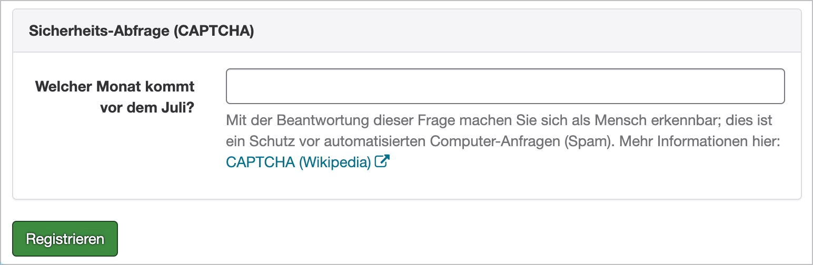
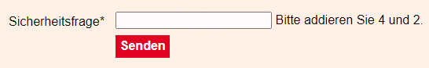
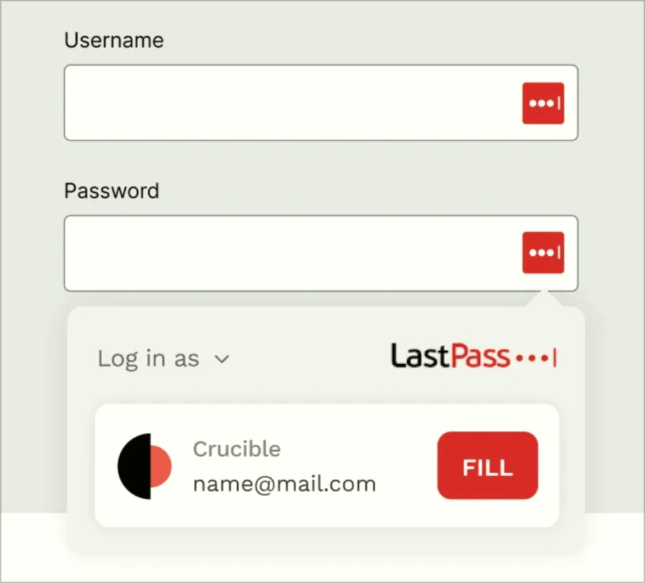
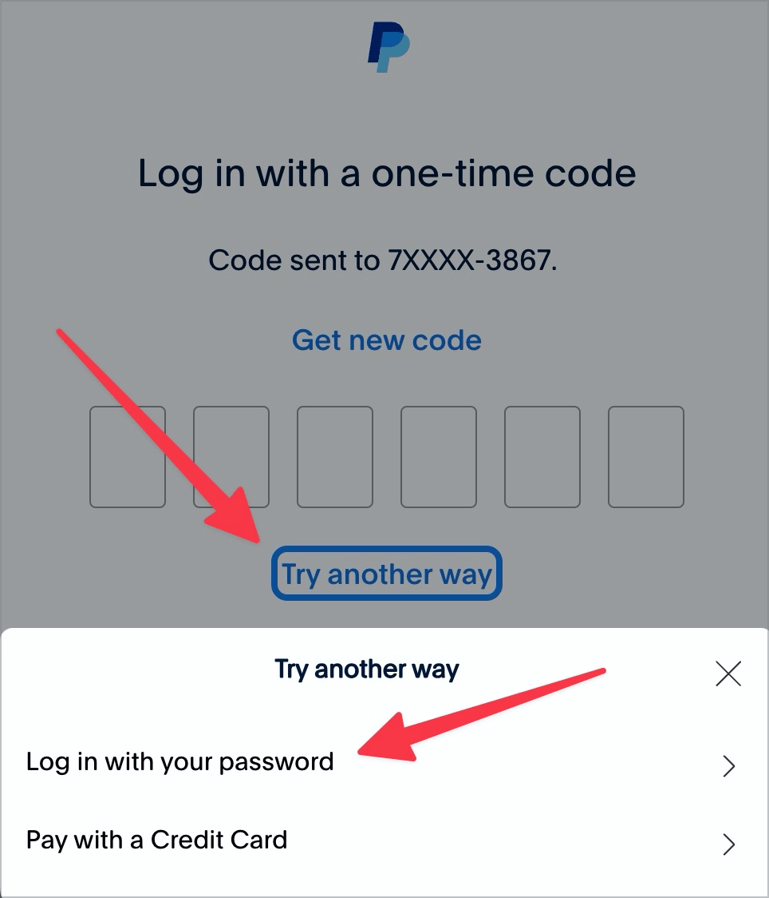
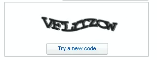
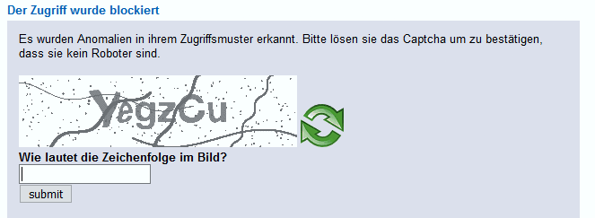
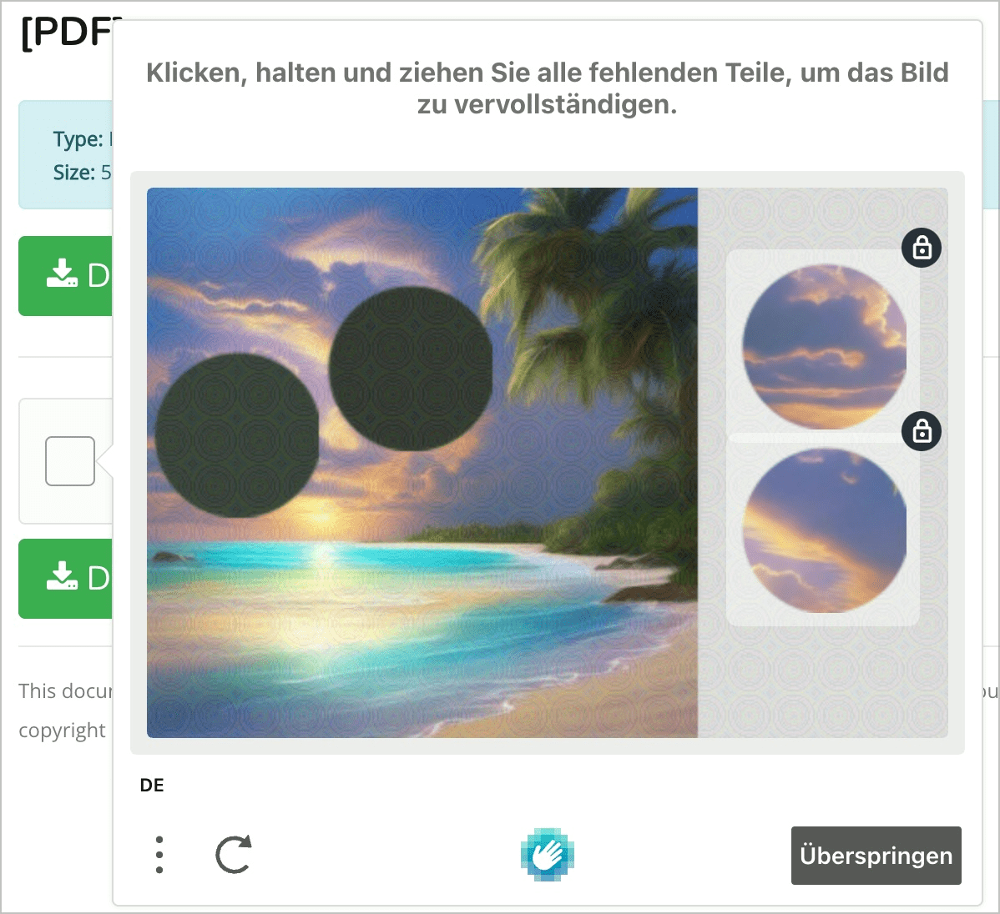
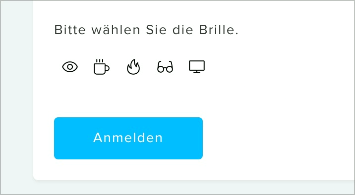

# ✅ Barrierefreies Authentifizieren

WCAG-Kriterium: [📜 3.3.8 Barrierefreie Authentifizierung (Minimum) - AA](..)

## Beschreibung

Mindestens eine der angebotenen Möglichkeiten zur Authentifizierung ist für die unterschiedlichen Nutzer-Gruppen barrierefrei. Insbesondere Copy & Paste ist nicht unterbunden.

## Prüfmethode (in Kürze)

**Manuelle Prüfung:** Angebotene Möglichkeiten zur Authentifizierung für unterschiedliche Nutzer-Gruppen prüfen.

## Prüfmethode für Web (ausführlich)

### Prüf-Schritte

1. Seite mit Authentifizierung öffnen
1. Sicherstellen, dass diese barrierefrei ist
    - **🙂 Beispiel:** Ein Nutzername und Passwort muss eingegeben werden
        - ⚠️ Wichtig ist, dass beim Nutzername `autocomplete="username"` sowie beim Passwort `autocomplete="current-password"` gesetzt sind, siehe [📜-1.3.5 Eingabezweck bestimmen](/de/wcag/1.3.5-eingabezweck-bestimmen)!
        - **🙂 Beispiel:** Statt ein Passwort zu fordern, wird eine Email an den Nutzer geschickt, welches z.B. einen Direkt-Link zum Einloggen anbietet (oder einen Code, der eingegeben werden muss bzw. via Copy&Paste übertragen werden kann)
    - **🙂 Beispiel:** Eine Webseite erlaubt das Einloggen über einen Drittanbieter (z.B. OAuth) oder das Wiederverwenden eines anderen Kontos (z.B. Github)
        - ⚠️ Wichtig hierbei ist natürlich, dass diese Anbieter barrierefreies Einloggen ermöglichen
    - **😡 Beispiel:** Eine Sicherheitsabfrage fordert logisches Denken, z.B. "Das Gegenteil von Süden ist?" oder "17 minus 5 ergibt?"
    - **🙄 Beispiel:** Eine Sicherheitsabfrage fordert Erkennen, z.B. "Wähle das Fahrrad" oder "Welches Tier hörst du?"
        - ⚠️ Solche Aufgaben, die z.B. nur über den visuellen oder auditiven Kanal lösbar sind, bringen natürlich eine Menge weiterer Probleme mit sich (ein typisches Problem von CAPTCHAs, siehe [✅ Grafische CAPTCHAs](/de/wcag/1.1.1-nicht-text-inhalt/grafische-captchas))! Sie sind nur dann akzeptabel, wenn sie für alle anderen Kanäle alternative Mechanismen anbieten.

## Prüfmethode für Mobile (Ergänzungen zu Web)

Sowohl auf Web-Views als auch native Inhalte 1:1 übertragbar.

## Prüfmethode für PDF (Ergänzungen zu Web)

Für PDF nicht relevant.

## Details zum blinden Testen

Barrierefreies Authentifizieren ist für Blinde besonders wichtig!

## Screenshots typischer Fälle

