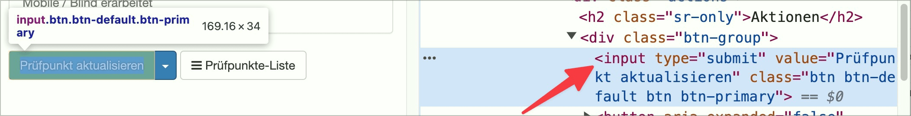
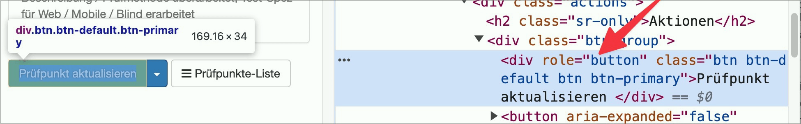

# ✅ Formular-Schalter korrekt umgesetzt

WCAG-Kriterium: [📜 4.1.2 Name, Rolle, Wert - A](..)

## Beschreibung

Formular-Schalter sind korrekt umgesetzt (als `<button>`-Element oder `<input type="submit">`-Element).

## Prüfmethode (in Kürze)

Formularelemente auflisten und prüfen, ob Schalter korrekt umgesetzt sind.

## Prüfmethode für Web (ausführlich)

1. Seite öffnen
1. Sicherstellen, dass Formular-Schalter korrekt umgesetzt sind
    - **🙂 Beispiel:** Schalter sind als `<input type="submit">` oder `<button>` umgesetzt
    - **🙄 Beispiel:** Schalter sind als `
` o.ä. umgesetzt → ⚠️ Das ist technisch zwar in Ordnung, aber dennoch nicht empfehlenswert
    - **😡 Beispiel:** Schalter sind als `
` o.ä. umgesetzt

## Prüfmethode für Mobile (Ergänzungen zu Web)

Auf Web-Views 1:1 übertragbar.

## Prüfmethode für PDF (Ergänzungen zu Web)

### Prüf-Schritte
1. PDF mit [🏷️ Adobe Reader](/de/tags/adobe-reader) öffnen
1. Mit [🏷️ NVDA Screenreader](/de/tags/nvda-screenreader) vorlesen lassen
1. Prüfen, dass Schalter mit einem Tooltip versehen sind und dass Formular-Felder die korrekte Rolle haben (zum Beispiel Textfeld für Textfelder, Checkbox für Kontrollkästchen etc.).

## Details zum blinden Testen

Teilweise.

## Screenshots typischer Fälle

