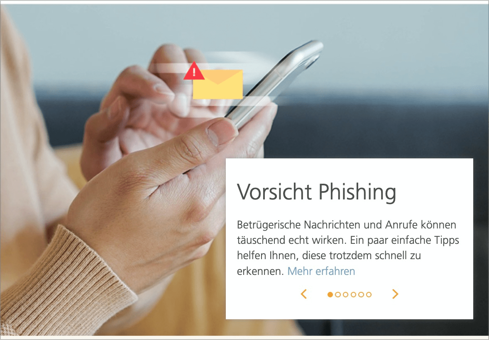

# ✅ Karusselle

WCAG-Kriterium: [📜 4.1.2a Erweiterte Steuerelemente (Widgets)](..)

## Beschreibung

Karusselle (Slider) sind barrierefrei umgesetzt. Sie werden durch Screenreader korrekt angesagt.

## Prüfmethode (in Kürze)

**Screenreader:** Mit Karussellen interagieren und sicherstellen, dass sie sich wie erwartet verhalten.

## Prüfmethode für Web (ausführlich)

### Prüf-Schritte

Die Implementierungen von Karussellen können sich stark von einander unterscheiden.

Die folgende Anleitung ist eine Annäherung an die aus der Praxis gebräuchlichsten Konventionen (siehe unten). Sie muss beim Testen an die jeweilige Situation angepasst werden. Generell gilt: wenn eine einzige Anforderung nicht erfüllt wird, so ist im Normalfall das gesamte Element als unzugänglich einzustufen!

1. Seite öffnen
1. Karussell mit Tastatur alleine bedienen und prüfen:
    - ⚠️ Probleme mit Tastatur alleine sind unter [✅ Mit der Tastatur bedienbar](/de/wcag/2.1.1-tastatur/mit-der-tastatur-bedienbar) zu bemängeln!
    - Bedien-Elemente zum Wechseln der angezeigten Folie fokussieren und mit `Enter` aktivieren (z.B. "Nächste Folie"- oder "Folie 5: Costa Rica"-Schalter)!
        - ⚠️ Manchmal kann mit `Links`/`Rechts` direkt zwischen Folien navigiert werden
    - Wird der Inhalt eingeblendet?
        - **🙂 Beispiel:** Die gewählte Folie wird angezeigt, z.B. Text und Foto zu "Ferienziel Costa Rica"
        - **😡 Beispiel:** Es passiert nichts
    - Falls sich interaktive Elemente im Inhalt befinden: können diese per `Tab` erreicht werden?
        - **🙂 Beispiel:** Ein Link zu weiteren Informationen / Buchung für Costa Rica kann erreicht werden
        - **😡 Beispiel:** Ein solcher Link kann **nicht** erreicht werden
        - **😡 Beispiel:** Ein solcher Link kann nur rückwärts (`Shift`-`Tab`) erreicht werden
    - Bei Auto-Rotation: kann der Mechanismus gestoppt werden?
        - **🙂 Beispiel:** Ein "Pausieren"-Schalter stoppt die Rotation
        - **🙄 Beispiel:** Sobald mit dem Karussell interagiert (z.B. die Folie gewechselt) wurde, stoppt die Rotation
        - **😡 Beispiel:** Die Rotation kann nicht gestoppt werden → unter [✅ Dauerhaft animierte Inhalte](/de/wcag/2.2.2-pausieren-stoppen-ausblenden/dauerhaft-animierte-inhalte) zu bemängeln!
    - Bei Scroll-Karussell: müssen alle Inhalte mit `Tab` durchlaufen werden?
        - **🙂 Beispiel:** Ein "Überspringen"-Schalter erlaubt das Überspringen der Inhalte → vgl. [✅ Sprunglinks](/de/wcag/2.4.1-bloecke-ueberspringen/sprunglinks)
        - **😡 Beispiel:** Alle Inhalte müssen durchlaufen werden
        - ⚠️ Screenreader sind hier im Vorteil, da sie diverse weitere Möglichkeiten haben, Inhalte zu überspringen, und nicht auf `Tab` angewiesen sind.
1. Karussell wie zuvor bedienen, dieses mal **mit Screenreader** (ggf. Seite neu laden), und prüfen:
    - ⚠️ Bedienung dürfte in etwa gleich sein wie mit Tastatur alleine
    - Vermittelt der Screenreader das Element adäquat?
        - **🙂 Beispiel:** "Karussell" / "Slider" o.ä.
        - **🙄 Beispiel:** Kein Hinweis → wenn das Element insgesamt auch sonst verständlich ist, benötigt es keinen expliziten Hinweis
    - Vermittelt der Screenreader, wenn zu einer anderen Folie gewechselt wird?
        - **🙂 Beispiel:** Beim Aktivieren des "Nächste Folie"-Schalters ertönt der Name der nun angezeigten Folie (z.B. "Ferienziel Costa Rica")
        - **🙄 Beispiel:** Es ertönt Rückmeldung "Nächste Folie" → besser wäre ein konkreter Hinweis auf den Inhalt
        - **🙂 Beispiel:** Beim Aktivieren des "Folie 5"-Schalters ertönt der Name der nun angezeigten Folie (z.B. "Ferienziel Costa Rica")
        - **🙄 Beispiel:** Es ertönt Rückmeldung "Folie 5"
        - **🙄 Beispiel:** Es ertönt Rückmeldung "Aktiv" / "Gedrückt" / "Ausgeklappt" o.ä.
        - **😡 Beispiel:** Keine Rückmeldung
    - Kann der Inhalt gelesen werden?
        - **🙂 Beispiel:** Der Inhalt wird beim Folien-Wechsel sofort vorgelesen → am besten nur wenn kurz und bündig
        - **🙂 Beispiel:** Der Inhalt wird mit `Runter` schnell erreicht
        - **😡 Beispiel:** Der Inhalt wird mit `Runter` übersprungen (er ist nur mit `Hoch` erreichbar)
        - **😡 Beispiel:** Der Inhalt wird nicht erreicht
    - Bei Auto-Rotation: kann der Mechanismus gestoppt werden?
        - **🙂 Beispiel:** Ein "Pausieren"-Schalter stoppt die Rotation
        - **🙄 Beispiel:** Sobald mit dem Karussell interagiert (z.B. die Folie gewechselt) wurde, stoppt die Rotation
        - **😡 Beispiel:** Die Rotation kann nicht gestoppt werden → unter [✅ Automatisch abspielender Audio-Inhalt](/de/wcag/1.4.2-audio-steuerelement/automatisch-abspielender-audio-inhalt) zu bemängeln!
        - ⚠️ Automatische Rotation kann für Screenreader-Nutzer insbesondere dann anstrengend sein, wenn das Karussell beim Wechsel der angezeigten Folie diese automatisch via Status-Nachricht ([✅ Statusmeldungen](/de/wcag/4.1.3-statusmeldungen/statusmeldungen)) ansagt, da dies zu regelmässiger Belästigung im Audio-Kanal führt → davon ist generell stark abzuraten!

### Konventionen

- Karusselle ähneln Tabs ([✅ Tabs / Tablisten](/de/wcag/4.1.2a-erweiterte-steuerelemente-widgets/tabs-tablisten)), sind aber oft komplexer und weniger standardisiert
- Die meisten Karusselle haben "**Nächste/Vorherige Folie** anzeigen"-Schalter
    - Manche haben für jede Folie einen eigenen "Folie 1/2/3... anzeigen"-Schalter
- Manche Karusselle haben eine **Auto-Rotation**, um die Folien in regelmässigem Abstand zu rotieren
    - Diese benötigen zwingend eine Möglichkeit, die Rotation zu stoppen
- Manche Karusselle **verstecken** alle Folien ausser die aktuell gezeigte; **Scroll-Karusselle** hingegen scrollen ihren Viewport nach links oder rechts, um die gewünschte Folie anzuzeigen
- Oft wird eine ausgefeilte ARIA-Implementierung verwendet (siehe [APG: Carousel (Slide Show or Image Rotator) Pattern](https://www.w3.org/WAI/ARIA/apg/patterns/carousel/)) → es gibt allerdings kein `role="carousel"`
    - Es kann aber auch ein einfaches `
` mit einer Link-Liste als Navigation sein; in Formularen können sogar Radiobuttons sinnvoll sein, siehe [ADG: Carousel](https://www.accessibility-developer-guide.com/examples/widgets/carousel/)

## Prüfmethode für Mobile (Ergänzungen zu Web)

Einerseits können in einer Mobile App beliebige Web-Inhalte (inkl. Karusselle) eingebettet sein; andererseits gibt es auch native Implementierungen.

## Prüfmethode für PDF (Ergänzungen zu Web)

So komplexe interaktive Elemente gibt's in PDFs nicht.

## Details zum blinden Testen

Karusselle **müssen** sogar mit einem Screenreader wie [🏷️ NVDA Screenreader](/de/tags/nvda-screenreader) geprüft werden!

## Screenshots typischer Fälle

