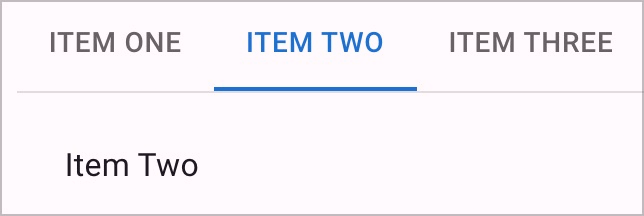
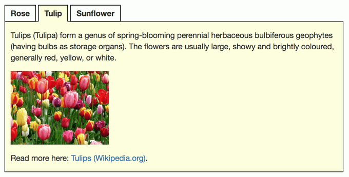
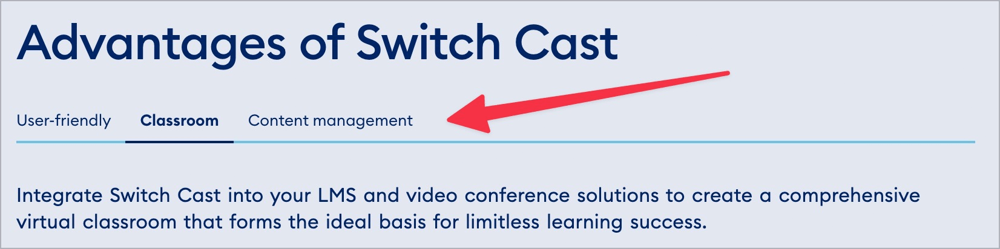

# ✅ Tabs / Tablisten

WCAG-Kriterium: [📜 4.1.2a Erweiterte Steuerelemente (Widgets)](..)

## Beschreibung

Tabs (Registerkarten) sind barrierefrei umgesetzt. Sie werden durch Screenreader korrekt angesagt, ihr Status wird vermittelt (z.B. "aktiv" bzw. "nicht aktiv").

## Prüfmethode (in Kürze)

**Screenreader:** Mit Tabs interagieren und sicherstellen, dass sie sich wie erwartet verhalten.

## Prüfmethode für Web (ausführlich)

### Prüf-Schritte

Die Implementierungen von Tabs können sich stark von einander unterscheiden.

Die folgende Anleitung ist eine Annäherung an die aus der Praxis gebräuchlichsten Konventionen (siehe unten). Sie muss beim Testen an die jeweilige Situation angepasst werden. Generell gilt: wenn eine einzige Anforderung nicht erfüllt wird, so ist im Normalfall das gesamte Element als unzugänglich einzustufen!

1. Seite öffnen
1. Tabs mit Tastatur alleine bedienen und prüfen:
    - ⚠️ Probleme mit Tastatur alleine sind unter [✅ Mit der Tastatur bedienbar](/de/wcag/2.1.1-tastatur/mit-der-tastatur-bedienbar) zu bemängeln!
    - Bedien-Elemente zum Wechseln des angezeigten Tab-Inhalts fokussieren und mit `Enter` aktivieren (z.B. "Montag")!
        - ⚠️ Manchmal kann mit `Links`/`Rechts` direkt zwischen Tab-Inhalten navigiert werden
    - Wird der Inhalt eingeblendet?
        - **🙂 Beispiel:** Der gewünschte Tab-Inhalt wird angezeigt, z.B. Meteo "Lokalprognose Montag"
        - **😡 Beispiel:** Es passiert nichts
    - Falls sich interaktive Elemente im Inhalt befinden: können diese per `Tab` erreicht werden?
        - **🙂 Beispiel:** Ein Link zu Detail-Informationen für Montag kann erreicht werden
        - **😡 Beispiel:** Ein solcher Link kann **nicht** erreicht werden
1. Tabs wie zuvor bedienen, dieses mal **mit Screenreader** (ggf. Seite neu laden), und prüfen:
    - ⚠️ Bedienung dürfte in etwa gleich sein wie mit Tastatur alleine
    - Vermittelt der Screenreader das Element adäquat?
        - **🙂 Beispiel:** "Tabs" / "Tabliste" oder ähnlich
        - **🙄 Beispiel:** Kein Hinweis → wenn das Element insgesamt auch sonst verständlich ist, benötigt es keinen expliziten Hinweis
    - Vermittelt der Screenreader, wenn ein Tab-Inhalt aktiviert wird?
        - **🙂 Beispiel:** Beim Aktivieren von "Dienstag" ertönt Hinweis "Aktiv" / "Gedrückt" / "Ausgeklappt" o.ä.
        - **😡 Beispiel:** Es ertönt kein Hinweis
    - Kann der Inhalt gelesen werden?
        - **🙂 Beispiel:** Der Inhalt wird mit `Runter` schnell erreicht
        - **😡 Beispiel:** Der Inhalt wird mit `Runter` übersprungen (er ist nur mit `Hoch` erreichbar)
        - **😡 Beispiel:** Der Inhalt wird nicht erreicht

### Konventionen

- Tabs ähneln Karussellen ([✅ Karusselle](/de/wcag/4.1.2a-erweiterte-steuerelemente-widgets/karusselle)), sind aber weniger komplex
- Tabs ähneln Akkordeons ([✅ Akkordeons](/de/wcag/4.1.2a-erweiterte-steuerelemente-widgets/akkordeons)), ihre Kontroll-Elemente befinden sich aber alle zusammen oberhalb des Inhalts-Bereichs und es kann jeweils nur der Inhalt eines einzigen Tabs angezeigt werden
- Tabs können auch **vertikal** ausgerichtet sein (übereinander, meist auf der linken Seite des Inhalts)
- Oft wird eine ausgefeilte ARIA-Implementierung verwendet (siehe [APG: Tabs Pattern](https://www.w3.org/WAI/ARIA/apg/patterns/tabs/)) → `role="tablist"` wird heutzutage gut unterstützt
    - Es kann aber auch ein einfaches `
` mit einer Link-Liste als Navigation sein; in Formularen können sogar Radiobuttons sinnvoll sein, siehe [ADG: Tabs](https://www.accessibility-developer-guide.com/examples/widgets/tabs/)

## Prüfmethode für Mobile (Ergänzungen zu Web)

Einerseits können in einer Mobile App beliebige Web-Inhalte (inkl. Tabs) eingebettet sein; andererseits gibt es auch native Implementierungen.

## Prüfmethode für PDF (Ergänzungen zu Web)

So komplexe interaktive Elemente gibt's in PDFs nicht.

## Details zum blinden Testen

Tabs **müssen** sogar mit einem Screenreader wie [🏷️ NVDA Screenreader](/de/tags/nvda-screenreader) geprüft werden!

## Screenshots typischer Fälle

