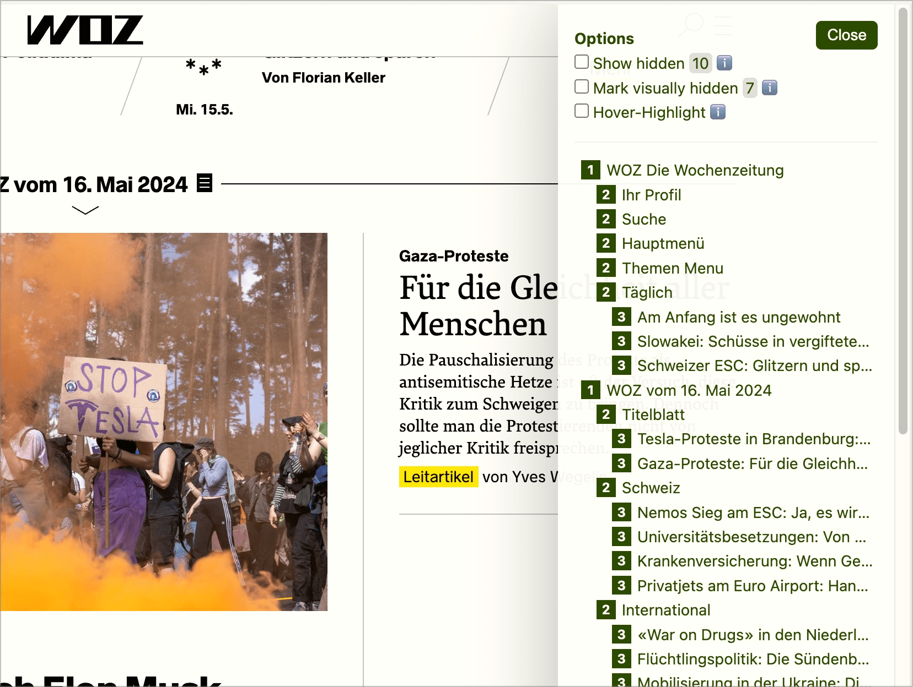
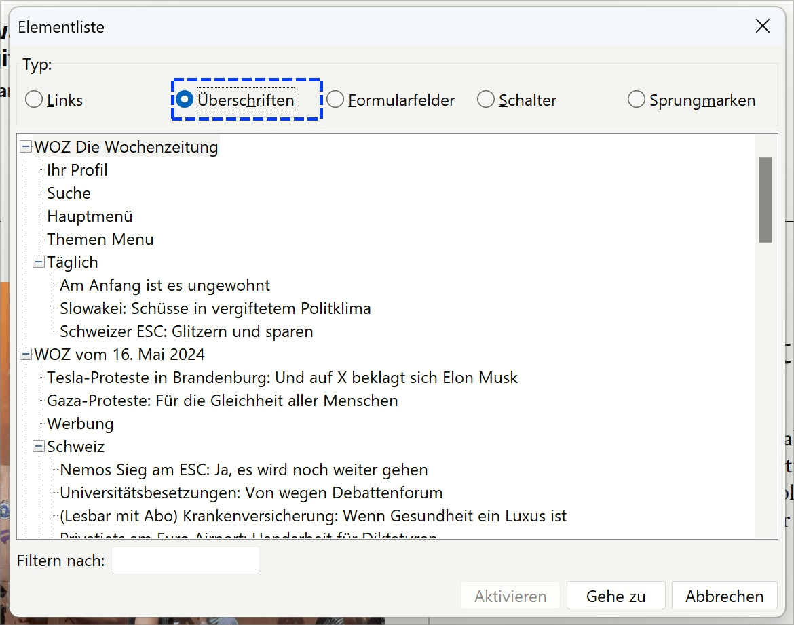

# ✅ Hierarchy of existing headings

Wcag criterion: [📜 1.3.1a Headings structure](..)

## Description

The hierarchy of the heading levels is logically correct in terms of content and conveys the structure of the content.

## Method

**Bookmarklet h123:** Execute and compare with page: Is the hierarchy logically correct?

## Details on web applicability (specific test steps)

🇩🇪 Currently only available in German.

## Details on mobile applicability (additions to web)

🇩🇪 Currently only available in German.

## Details on PDF applicability (additions to web)

🇩🇪 Currently only available in German.

## Blind testable details

🇩🇪 Currently only available in German.

## Screenshots

