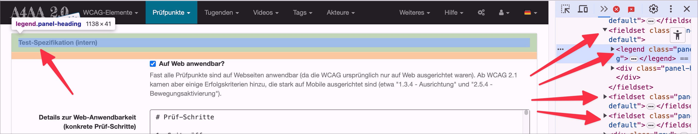

# ✅ Feldset / Legend

Wcag criterion: [📜 1.3.1c Forms, Labels and Fieldsets](..)

## Description

In extensive forms, form fields with related content are grouped using the `<fieldset>`/`<legend>` combination.

## Method

In extensive forms, form fields with related content are grouped using the `<fieldset>`/`<legend>` combination.

## Details on web applicability (specific test steps)

🇩🇪 Currently only available in German.

## Details on mobile applicability (additions to web)

🇩🇪 Currently only available in German.

## Details on PDF applicability (additions to web)

🇩🇪 Currently only available in German.

## Blind testable details

🇩🇪 Currently only available in German.

## Screenshots

