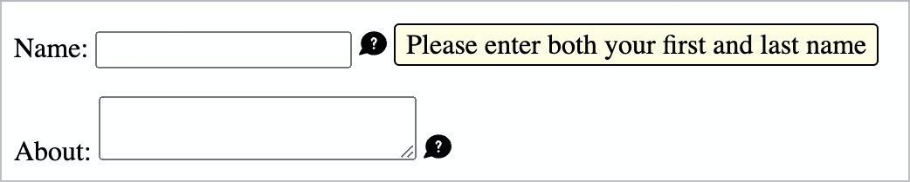

# ✅ QuickInfos / Toggletips

Wcag criterion: [📜 4.1.2a Advanced controls (widgets)](..)

## Description

Tooltips are implemented barrier-free. Simple, short content is immediately announced by screen readers. If tooltips contain complex content, it must be possible to read them manually (in this case it is more of a dialog).

## Method

**Screenreader:** Interact with tooltips and make sure they behave as expected **Keyboard:** Repeat the above procedure.

## Details on web applicability (specific test steps)

🇩🇪 Currently only available in German.

## Details on mobile applicability (additions to web)

🇩🇪 Currently only available in German.

## Details on PDF applicability (additions to web)

🇩🇪 Currently only available in German.

## Blind testable details

🇩🇪 Currently only available in German.

## Screenshots

